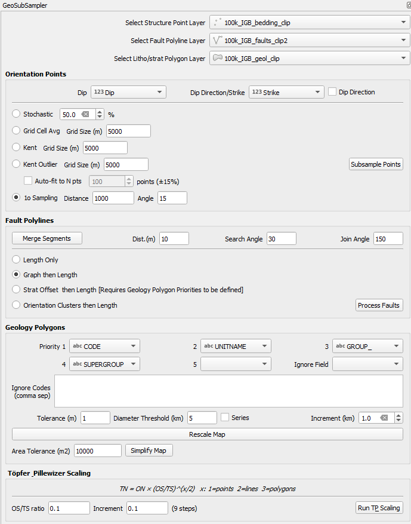

# GeoSubSampler

A QGIS and ArcGIS Pro plugin for subsampling geological orientations, faults, and polygons. This plugin provides various methods to reduce the complexity of geological datasets while preserving important structural information.

## Overview

GeoSubSampler is designed to help geologists and GIS professionals manage large geological datasets by providing intelligent subsampling methods. The plugin supports processing of:
- Structural orientation data (dip/strike measurements)
- Geological polygons (rock units, formations)
- Fault and contact lines

Beyond subsampling it can also clean a polygon and fault map so that it is topologically consistent (**Fix Map**),
add shared nodes to it (**Densify Nodes**), read the
stratigraphic offset across faults, simplify a map while preserving its topology, and rescale a whole map
following the Töpfer & Pillewizer rule.




## Installation (QGIS)

1. Install the [QPIP](https://plugins.qgis.org/plugins/a00_qpip/) plugin through QGIS Plugin Manager
2. Download the plugin files (works with QGIS 3.x and 4.x)
3. Place them in your QGIS plugins directory
4. Restart QGIS. QPIP will offer to install any missing Python packages listed in `requirements.txt`
5. Enable the plugin through QGIS Plugin Manager
6. The plugin will appear as a dockable widget in QGIS

## ArcGIS Pro version

### Where the results go
Every time you press a button, the results (shapefiles, reports, progress files) are written to a **new folder named
after the tool and the time**, e.g. `Fix_map_20261105_164049`, next to the input layer (or in the project / temp
folder if that is not writable). A series (Rescale Map, Töpfer & Pillewizer scaling) puts all its steps in one
folder; the next button press starts a new one, so earlier results are never overwritten or mixed up. In QGIS the
new layers are added to a layer-panel group called **Outputs** (created if it does not exist), newest on top.

An ArcGIS Pro equivalent of the plugin is in the [ARCGIS](ARCGIS/) folder. It is a Python toolbox
(`ARCGIS/GeoSubSampler.pyt`) whose **Launch GeoSubSampler GUI** tool opens a Tkinter window with the same
groups and settings as the QGIS dock widget (orientation subsampling, fault processing, geology polygons
including Densify Nodes, and Töpfer & Pillewizer scaling), using the same `calcs` code. The window lists the point, line and polygon
layers in your project, and results are added to the map automatically with the symbology of the layer they
were made from.

The ArcGIS Pro Python environment needs `geopandas` (not included by default) and, if not already installed,
`scikit-learn`, `networkx`, `scipy`, `matplotlib`, `fiona` and `triangle`. See [ARCGIS/README.md](ARCGIS/README.md) for
installation and usage notes.

### Setting up the ArcGIS Pro Python environment

The toolbox has a tool that sets up the environment for you. ArcGIS Pro's default environment
(arcgispro-py3) cannot be changed, so the tool clones it into a new environment called
`arcgispro-py3-geotools`, installs the missing packages, checks that they all import, and makes the new
environment the one ArcGIS Pro uses.

> **Note:** the tool creates a **new** environment, `arcgispro-py3-geotools`, as a copy of `arcgispro-py3`. It does not change `arcgispro-py3` or any other environment you already have. It then makes the new environment the one ArcGIS Pro uses, so **restart ArcGIS Pro** when it has finished. To go back, choose another environment in **Project > Package Manager** and restart ArcGIS Pro. The tool cannot change or delete the environment ArcGIS Pro is using at the time, so to run it again with *Delete the environment first*, switch to another environment and restart first.

1. In the ArcGIS Pro Catalog pane, go to **Toolboxes > Add Toolbox** and select `ARCGIS/GeoSubSampler.pyt`.
2. In the GeoSubSampler toolbox, open **Setup > Set Up Python Environment** and click **Run**. It needs an
   internet connection and takes about 10 minutes. Click **View Details** in the Geoprocessing pane to
   follow its progress.
3. When it has finished, **restart ArcGIS Pro**, then run **Launch GeoSubSampler GUI**.

The same tool is in the **SGTool**, **tomofast_x_q** and **GeoSubSampler** toolboxes and installs what all
three need, so you only need to run it once. Running it again only adds what is missing. Its options let you
choose a different environment name, leave ArcGIS Pro's active environment unchanged (activate it later in
Package Manager), or delete the environment and start again from a new clone.

The tool runs the script `ARCGIS/setup_arcgispro_env.py`, which can also be run from a Windows Command Prompt
(change the paths if ArcGIS Pro or this repository are somewhere else):
```
"C:\Program Files\ArcGIS\Pro\bin\Python\envs\arcgispro-py3\python.exe" "C:\path\to\GeoSubSampler\ARCGIS\setup_arcgispro_env.py"
```

## Features

### 1. Structural Orientation Subsampling

#### Input Field Configuration

##### Structural Data Fields
- **Layer Selection**: Choose the point layer containing structural measurements
- **Dip Field**: Field containing dip angle values
  - *Type*: Numeric field from selected layer
  - *Description*: Angle of dip from horizontal (0-90°). If this field holds values outside 0-90° the
    tools stop with a message, because the Dip and Dip Direction/Strike fields have most likely been swapped
- **Dip Direction/Strike Field**: Field containing directional information
  - *Type*: Numeric field from selected layer
  - *Description*: Either dip direction (0-360°) or strike direction
- **Dip Direction Checkbox**: Toggle between dip direction and strike convention
  - *Description*: Check if using dip direction, uncheck if using strike

##### Contact/Boundary Data
- **Polyline Layer**: Layer containing geological contacts or boundaries
  - *Type*: Line layer
  - *Description*: Used for first-order subsampling relative to geological boundaries   

#### Stochastic Subsampling
Randomly samples a percentage of orientation points.

**Parameters:**
- **Retain Percentage**: Percentage of points to keep (0-100%)
  - *Type*: Float
  - *Range*: 0.0 - 100.0
  - *Description*: Controls what fraction of the original dataset is retained

#### Kent Statistics Grid Averaging
Averages the orientations within each grid cell (the normalised vector mean) and reports Kent distribution
statistics for the cell. Each output point sits at the mean position of the cell's measurements and carries
`count`, `kappa` (concentration) and `beta` (ovalness) attributes. (A plain grid-cell average is the same
calculation without kappa and beta, so it is no longer offered separately.)

**Parameters:**
- **Grid Size (Kent)**: Grid cell size for Kent statistical averaging
  - *Type*: Float
  - *Units*: Layer units
  - *Description*: Grid size for applying Kent distribution statistics
- **Min kappa** (optional): Keep a cell only if its Kent kappa (concentration) is at least this value
  - *Type*: Float; leave blank (or 0) for no filter
  - *Description*: Drops cells with a single measurement and cells whose orientations are scattered
    (the thesis models used 5). Cells that survive carry `count`, `kappa` and `beta` attributes
    (-998 where undefined). Not applied by the Töpfer & Pillewizer tool.

#### Kent Statistics with Outlier Removal
Applies Kent statistics while removing the largest outliers within each grid cell.

**Parameters:**
- **Grid Size (Kent Outlier)**: Grid cell size for Kent averaging with outlier removal
  - *Type*: Float
  - *Units*: Layer units
- **Outlier Threshold**: Threshold for outlier identification and removal
  - *Type*: Float
  - *Description*: Statistical threshold for identifying and removing outliers
- **Iterative** (experimental): Remove several outliers per cell instead of one. Points are taken out in order of
  how much their removal raises Kent kappa (up to half the cell) and the sequence is cut at its largest kappa
  jump, but only if that jump is at least 5 times the typical step; otherwise nothing is removed (removing any
  point from a small sample raises kappa a little, so a plain "stop when kappa stops rising" rule over-trims).
  This differs from the Carmichael method below, which orders points by angle from the cell mean.

#### Carmichael Iterative Outlier Removal
Kent averaging that can remove **several** outliers per grid cell (Carmichael & Ailleres, 2016), where
Kent Outlier removes at most one. In each cell the measurements are ranked by angle from the cell's mean
direction (farthest first) and removed one at a time while Kent kappa is recomputed; everything removed up
to the biggest jump in kappa is treated as outliers (at most half the cell). Cells with 3 or fewer
measurements are skipped. Output points carry `count`, `kappa`, `beta` and `n_removed` attributes.

**Parameters:**
- **Grid Size (Carmichael)**: Grid cell size, in layer units. "Auto-fit to N pts" works as for the other grid methods.

#### First Order Subsampling
Retains orientation points based on proximity to geological contacts and angular relationships.

**Parameters:**
- **Distance Buffer**: Buffer distance around geological contacts
  - *Type*: Float
  - *Units*: Layer units
  - *Description*: Points within this distance of contacts are prioritized
- **Angle Tolerance**: Angular tolerance for point retention
  - *Type*: Float
  - *Units*: Degrees
  - *Description*: Tolerance for angular relationships between measurements and contacts

### 2. Fault/Line Processing

#### Segment Merging
Merges connected fault segments based on geometric criteria.   
About half a second for 1,400 faults; the time grows roughly in proportion to the number of faults.   

**Parameters:**
- **Distance Tolerance**: Maximum distance between line endpoints for merging
  - *Type*: Float
  - *Units*: Layer units
  - *Description*: Endpoints closer than this distance are candidates for merging
- **Search Angle Tolerance**: Maximum angle difference for parallel lines
  - *Type*: Float
  - *Units*: Degrees
  - *Description*: Lines with orientations within this tolerance are considered parallel
- **Join Angle**: Minimum angle at connection points
  - *Type*: Float
  - *Units*: Degrees
  - *Description*: Rejects connections that create angles smaller than this value

#### Length-Based Subsampling
Filters fault lines based on minimum length criteria.

**Parameters:**
- **Minimum Fault Length**: Calculate length for faults   
  - Does not actual filter, just creates new layer   

- **Fault Graph**: Calculate Network Graph parameters for fault network   
  - Does not actual filter, just creates new layer   

- **Fault Stratigraphic Offset**: Stratigraphic offset across each fault   
  - The geology is read on each side of the fault (a few metres either side) at **every point where the fault
    crosses a geological contact** (polygon boundary), which includes triple junctions on the fault. Where a
    fault runs along a contact the middle of the shared section is used. Faults that meet no contact are
    sampled at their start, middle and end (stepping 50 m either side), so every fault gets an answer.
  - Each fault gets its maximum offset level (`max_off_lv`: -1 edge of map, 0 no offset, higher numbers a more
    general stratigraphic level at which the two sides differ), where it was found (`max_off_x`, `max_off_y`),
    how many samples were used (`n_samples`), and how many showed an offset (`n_offset`), no offset
    (`n_nooffset`) or the edge of the map (`n_edge`); `sample_src` is `contacts` or `ends`.
  - The sample points themselves are saved as `<output>_samples.shp` (fault, location, offset level and the
    units on each side) and added to the map.
  - Does not actual filter, just creates new layer   

### 3. Polygon Processing

#### Minimum Area Filtering
Removes small polygons and fills holes based on area thresholds.

**Parameters:**
- **Minimum Polygon Diameter**: Threshold diameter for polygon retention
  - *Type*: Float
  - *Units*: Kilometers
  - *Description*: Polygons with equivalent diameter smaller than this are removed/merged
- **Node Tolerance**: Tolerance for node snapping during processing
  - *Type*: Float
  - *Units*: Layer units
  - *Description*: Distance tolerance for merging nearby vertices

#### Stratigraphic Priority Fields
Define the hierarchy for polygon merging decisions:
- **Priority 1-5 Fields**: Stratigraphic fields in order of importance
  - *Type*: Attribute fields from polygon layer
  - *Description*: Used to determine which polygon attributes are preserved during merging
  - *Order*: Priority 1 has highest importance, Priority 5 has lowest

#### Lithological Classification
- **Lithology Field**: Field containing lithological information
  - *Type*: Attribute field
  - *Description*: Used for lithological classification during polygon processing

#### Dyke/Intrusion/Alluvium Handling
- **Ignore Field**: Field identifying polygons that are removed by triangulation then merging, not by merging
  - *Type*: Attribute field
- **Ignore Codes**: Comma-separated list of codes identifying dykes/intrusions/alluvium that are best removed by triangulation, given their aspect ratio
  - *Format*: Text list (e.g., DY1, DY2, INTX-D )
  - *Description*: Special processing applied to polygons with these codes

#### Series Processing Options
- **Series Checkbox**: Enable processing of multiple scales
  - *Description*: When checked, creates multiple outputs at different scales
- **Increment Value**: Step size for series processing
  - *Type*: Float
  - *Units*: Same as minimum diameter
  - *Description*: Increment between successive processing scales

#### Modified Visvalingam-Whyatt Topological Map simplification
- **Area Tolerance (m2)**: Area threshold for exterior vertices
  - *Description*:  Decimates map polygons and associated faults composed of line segments to a similar curves with fewer vertices. Vertices to be removed are those whose triangular area (area defined by the vertex and its two neighbours) exceeds the threshold. When a polygon vertex is to be removed that coincides with a fault vertex, the two will be removed together to maintain their topological relationships.

#### Fix Map
*A full explanation of the process, step by step, is in [How Fix Map works](docs/FixMap.md).*

Cleans up the small digitising errors that stop a geological map from being topologically perfect, within a
**Tolerance (m)** (degrees are converted approximately). No vertex ends up more than the tolerance from where it started.
It handles, in order:

1. invalid polygons are repaired (`buffer(0)`; also available on its own as **Repair (buffer 0)**);
2. exact duplicate polygons and faults are removed (the first is kept);
3. a polygon lying (at least 90% of its area) inside a larger polygon gets cut out of it as a hole;
4. small gaps and overlaps between polygons are closed, nodes missing on one side of a shared boundary are added,
   near-coincident nodes at triple junctions become one node, and faults that run almost along a contact or
   another fault are snapped onto it and share its nodes. Bigger polygons are never moved by smaller ones, and
   polygons are never moved by faults (longer faults win over shorter ones);
5. nodes are added where polygon boundaries and faults cross, so crossing features share a node (this is what
   Fault Graph needs to connect faults).

- **Remaining overlaps**: overlaps left at the end (of any width, e.g. two polygons that partly
  cover each other) are cut out of one of the two polygons, so that no polygons overlap any more. *Keep smaller
  polygon* (default) cuts the overlap out of the bigger polygon, as for a polygon inside another; *Keep larger
  polygon* cuts it out of the smaller one; *Leave overlaps* does nothing. A polygon that is entirely overlapped
  disappears (listed in the report).
- **Fill enclosed gaps** (on by default): every gap completely surrounded by polygons, whatever its width or
  size, is added to the neighbouring polygon that shares the longest boundary with it. This is done first, before
  anything is snapped (the filled polygon takes over its neighbours' own vertices along the gap), and again at the
  end for any gap made since. Gaps along the edge of the map are not touched. Untick it to keep wide unmapped
  areas (e.g. lakes) as holes.

No vertex is moved by more than the tolerance (the report gives the largest move). Two vertices that snapped onto
the same nodes can leave a straight chord where the original line had a short detour, so a new line can lie
further than the tolerance from the original at a few places; the report gives that distance too.

A polygon that lies on top of a bigger one has a hole cut in the bigger one. If smaller polygons completely
cover a bigger one, nothing is left of it and it is removed; the report lists these.

With *Fill enclosed gaps* and *Remaining overlaps* on, no enclosed gap or overlap is left, whatever its width;
with them off, gaps and overlaps wider than the tolerance remain. A text
report (before -> after counts of unmatched nodes, near-duplicate nodes, invalid polygons, duplicates, polygons
inside polygons, gaps and overlap area, plus the index of every removed feature) is shown, logged and saved as
`<layer>_fixed_<tol>_report.txt`, in the run folder with the output layers (named `<layer>_fixed_<tol>`).
Checked on a 1,900-polygon / 4,430-fault map (670,000 / 350,000 vertices, about 3 minutes): GEOS had to add 6,727
nodes to node the original linework and none to node the result.

#### Densify Nodes
Inserts nodes so that no segment is longer than a chosen spacing, **keeping polygons and faults topologically
consistent**: a new node on a boundary shared by two polygons, or run along by a fault, is the same node in
all of them. (Densifying each polygon separately does not give this: tiny floating-point differences between
the two directions in which a shared edge is traversed leave the two copies with slightly different nodes.)

- **Node Spacing (m)**: the largest distance between nodes. Each segment is divided into equal parts no longer
  than this, so new nodes are between half the spacing and the spacing apart. Shapes do not change. For
  geographic coordinates the distance is converted from degrees approximately (111 km per degree of latitude,
  scaled by cos(latitude) for longitude).
- **Shared node at fault crossing**: also adds a node, shared by both features, where a fault or polygon boundary
  crosses a polygon boundary, and where a vertex lies on another feature's segment (a T-junction).
- Vertices closer together than 1 micrometre are merged first: nodes that are "shared" in a file are often
  only shared to within rounding noise, which would otherwise leave the two sides with different nodes.
- Uses the selected polygon and/or fault layer; with both, nodes are shared between them. Output layers are
  named `<layer>_dense_<spacing>`. About half a second for 1,100 polygons and 1,400 faults.

## Töpfer-Pillewizer 1996 rescaling
The TP scaling rule: TN = ON * (OS/TS)^(x/2)   
- TN  — target number of objects after generalisation
- ON  — original number of objects before generalisation
- OS  — original map scale denominator (e.g. 50 000)
- TS  — target map scale denominator (e.g. 500 000)
- x   — object type: 1 = points, 2 = lines, 3 = polygons

This will use the currently set parameters for each type of data to calculate a series of subsampling calculations to try to match the TP rule. The Old Scale/New Scale ratio defines the amount of subsampling, and Increment term defines how many steps (and hence sets of layers) will be calculated.   
   
## Technical Notes

### Coordinate System Handling
- **Geographic Coordinates**: Grid sizes are automatically converted from meters to degrees (÷110,000)
- **Projected Coordinates**: Grid sizes are used directly in the specified units

### File Format Requirements
- Input layers must be saved as shapefiles on disk
- The plugin cannot process temporary or memory layers

### Output Naming Convention
Output files follow the pattern: `[original_name]_[method]_[parameters].shp`
- If a file with the same name exists, a random 5-digit suffix is added

### Performance Considerations
Typical times on real data (28,600 bedding points; 1,121 polygons with 144,000 vertices; 1,403 faults):
- Kent / Kent Outlier / Carmichael grid methods: about a second at 5 km cells. The iterative Kent Outlier
  option grows with the square of the number of points in the largest cell, so very large cells (several
  thousand points) are slow.
- First Order sampling: about a second (it was ~100 s before it used a spatial index).
- Merge Segments, Fault Length, Fault Graph, Fault Strat Offset, Densify: from a fraction of a second to a few
  seconds. Cluster faults: several seconds.
- Rescale Map: a few seconds. Simplify Map: the slowest tool (about 10-15 s here); most of the time is in
  the topology preparation rather than in the simplification itself.
- Auto-fit to N points counts grid cells directly and no longer reruns the method for each trial size.
- The heavier libraries (matplotlib, scikit-learn, networkx) are loaded only when a tool that needs them is
  first used, so the plugin starts quickly.

## Error Handling

The plugin includes validation for:
- Missing required fields
- Invalid layer selections
- File access permissions
- Coordinate system compatibility

## Dependencies

- QGIS Python API (PyQt, qgis.core)
- Shapely (2.0 or later; its STRtree is used for polyline merging)
- NumPy
- pandas
- GeoPandas
- Fiona
- SciPy
- Matplotlib
- scikit-learn
- NetworkX
- triangle (only needed for polygon triangulation)

These are listed in `requirements.txt`. Most of them ship with QGIS; scikit-learn, NetworkX and triangle usually need to be installed. If the [QPIP](https://plugins.qgis.org/plugins/a00_qpip/) plugin is installed it adds them automatically from `requirements.txt`; otherwise install them with QPIP or pip before enabling GeoSubSampler. If any are missing, GeoSubSampler does not fail to load: it shows a warning naming them, and its button explains how to install them.

## License

This program is free software under the MIT License.   

## Future work   
- Add Ranee's code for simplification of fault/polygon sets preserving topology
- Simplify fault arrays suing topological constraints   
   
## Author

**Ranee Joshi-most calculation code**  
Email: raneejoshi@gmail.com   
**Mark Jessell-some calculation code & GUI**  
Email: mark.jessell@uwa.edu.au@gmail.com   
   
## Version Information

- Current version: 0.5
- Begin Date: 2025-07-28
- Generated by: Plugin Builder
- Plugin Builder: http://g-sherman.github.io/Qgis-Plugin-Builder/

## Changelog

**0.5**
- *Faster:* First Order sampling (~100x, using a spatial index), Kent / Carmichael grid methods (Kent ~55x,
  Carmichael ~28x, Kent Outlier 5-6x, the iterative option ~2.5x), Visvalingam-Whyatt simplification, Rescale Map
  (~2x), Merge Segments (~7x), Fault Graph, Cluster faults. Results are identical to the previous version except
  where noted below. The heavier libraries (matplotlib, scikit-learn, networkx, fiona) load only when first
  needed, so the plugin starts faster.
- *New:* **Fix Map** (QGIS and ArcGIS Pro) - repairs invalid polygons, removes doubled polygons and faults, cuts holes
  for polygons inside polygons, closes small gaps/overlaps, matches nodes along shared boundaries and at triple
  junctions, snaps faults onto nearby contacts, and writes a text report.
- *New:* **Densify Nodes** (QGIS and ArcGIS Pro) - shared new nodes along polygon and fault boundaries.
- *Changed:* **Fault Strat Offset** samples every fault/contact crossing instead of only the start, middle and
  end of each fault, and saves the sample points and extra per-fault columns (see above). **Cluster faults**
  writes only the best result (`write_all=True` in the code writes one file per cluster count). **First Order**
  now uses the best-aligned of several equally near contact segments, so its result no longer depends on the
  order of the data (it can keep a few more points than before).

**0.4** - New Kent estimator with an optional Min kappa filter and count / kappa / beta attributes; Kent Outlier
with an optional iterative mode; new Carmichael outlier method; Grid Cell Avg removed (identical to Kent without
kappa); much faster auto-fit to N points; a check that stops the run when the Dip field holds values outside
0-90 degrees (Dip and Dip Direction fields swapped).

**0.3.1** - Loads on QGIS 4 (Qt6) as well as QGIS 3.

**0.3** - ArcGIS Pro version (Python toolbox with a Tkinter interface).

---

*Note: This plugin requires layers to be saved as shapefiles for processing. Ensure your data is properly saved before attempting to use the subsampling functions.*