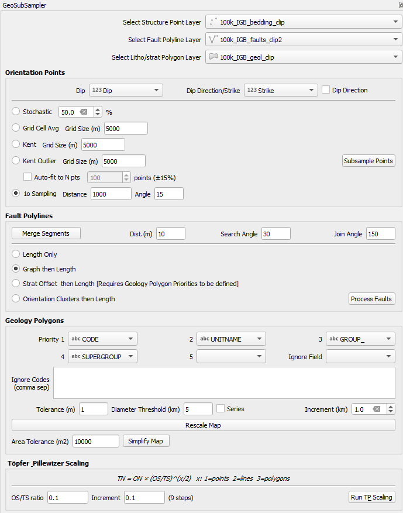

# GeoSubSampler

A QGIS and ArcGIS Pro plugin for subsampling geological orientations, faults, and polygons. This plugin provides various methods to reduce the complexity of geological datasets while preserving important structural information.

## Overview

GeoSubSampler is designed to help geologists and GIS professionals manage large geological datasets by providing intelligent subsampling methods. The plugin supports processing of:
- Structural orientation data (dip/strike measurements)
- Geological polygons (rock units, formations)
- Fault and contact lines




## Installation (QGIS)

1. Install the [QPIP](https://plugins.qgis.org/plugins/a00_qpip/) plugin through QGIS Plugin Manager
2. Download the plugin files (works with QGIS 3.x and 4.x)
3. Place them in your QGIS plugins directory
4. Restart QGIS. QPIP will offer to install any missing Python packages listed in `requirements.txt`
5. Enable the plugin through QGIS Plugin Manager
6. The plugin will appear as a dockable widget in QGIS

## ArcGIS Pro version (v0.3)

An ArcGIS Pro equivalent of the plugin is in the [ARCGIS](ARCGIS/) folder. It is a Python toolbox
(`ARCGIS/GeoSubSampler.pyt`) whose **Launch GeoSubSampler GUI** tool opens a Tkinter window with the same
groups and settings as the QGIS dock widget (orientation subsampling, fault processing, geology polygons and
Töpfer & Pillewizer scaling), using the same `calcs` code. The window lists the point, line and polygon
layers in your project, and results are added to the map automatically with the symbology of the layer they
were made from.

The ArcGIS Pro Python environment needs `geopandas` (not included by default) and, if not already installed,
`scikit-learn`, `networkx`, `scipy`, `matplotlib`, `fiona` and `triangle`. See [ARCGIS/README.md](ARCGIS/README.md) for
installation and usage notes.

### Setting up the ArcGIS Pro Python environment

The toolbox has a tool that sets up the environment for you. ArcGIS Pro's default environment
(arcgispro-py3) cannot be changed, so the tool clones it into a new environment called
`arcgispro-py3-geotools`, installs the missing packages, checks that they all import, and makes the new
environment the one ArcGIS Pro uses.

> **Note:** the tool creates a **new** environment, `arcgispro-py3-geotools`, as a copy of `arcgispro-py3`. It does not change `arcgispro-py3` or any other environment you already have. It then makes the new environment the one ArcGIS Pro uses, so **restart ArcGIS Pro** when it has finished. To go back, choose another environment in **Project > Package Manager** and restart ArcGIS Pro. The tool cannot change or delete the environment ArcGIS Pro is using at the time, so to run it again with *Delete the environment first*, switch to another environment and restart first.

1. In the ArcGIS Pro Catalog pane, go to **Toolboxes > Add Toolbox** and select `ARCGIS/GeoSubSampler.pyt`.
2. In the GeoSubSampler toolbox, open **Setup > Set Up Python Environment** and click **Run**. It needs an
   internet connection and takes about 10 minutes. Click **View Details** in the Geoprocessing pane to
   follow its progress.
3. When it has finished, **restart ArcGIS Pro**, then run **Launch GeoSubSampler GUI**.

The same tool is in the **SGTool**, **tomofast_x_q** and **GeoSubSampler** toolboxes and installs what all
three need, so you only need to run it once. Running it again only adds what is missing. Its options let you
choose a different environment name, leave ArcGIS Pro's active environment unchanged (activate it later in
Package Manager), or delete the environment and start again from a new clone.

The tool runs the script `ARCGIS/setup_arcgispro_env.py`, which can also be run from a Windows Command Prompt
(change the paths if ArcGIS Pro or this repository are somewhere else):
```
"C:\Program Files\ArcGIS\Pro\bin\Python\envs\arcgispro-py3\python.exe" "C:\path\to\GeoSubSampler\ARCGIS\setup_arcgispro_env.py"
```

## Features

### 1. Structural Orientation Subsampling

#### Input Field Configuration

##### Structural Data Fields
- **Layer Selection**: Choose the point layer containing structural measurements
- **Dip Field**: Field containing dip angle values
  - *Type*: Numeric field from selected layer
  - *Description*: Angle of dip from horizontal (0-90°). If this field holds values outside 0-90° the
    tools stop with a message, because the Dip and Dip Direction/Strike fields have most likely been swapped
- **Dip Direction/Strike Field**: Field containing directional information
  - *Type*: Numeric field from selected layer
  - *Description*: Either dip direction (0-360°) or strike direction
- **Dip Direction Checkbox**: Toggle between dip direction and strike convention
  - *Description*: Check if using dip direction, uncheck if using strike

##### Contact/Boundary Data
- **Polyline Layer**: Layer containing geological contacts or boundaries
  - *Type*: Line layer
  - *Description*: Used for first-order subsampling relative to geological boundaries   

#### Stochastic Subsampling
Randomly samples a percentage of orientation points.

**Parameters:**
- **Retain Percentage**: Percentage of points to keep (0-100%)
  - *Type*: Float
  - *Range*: 0.0 - 100.0
  - *Description*: Controls what fraction of the original dataset is retained

#### Kent Statistics Grid Averaging
Averages the orientations within each grid cell (the normalised vector mean) and reports Kent distribution
statistics for the cell. Each output point sits at the mean position of the cell's measurements and carries
`count`, `kappa` (concentration) and `beta` (ovalness) attributes. (A plain grid-cell average is the same
calculation without kappa and beta, so it is no longer offered separately.)

**Parameters:**
- **Grid Size (Kent)**: Grid cell size for Kent statistical averaging
  - *Type*: Float
  - *Units*: Layer units
  - *Description*: Grid size for applying Kent distribution statistics
- **Min kappa** (optional): Keep a cell only if its Kent kappa (concentration) is at least this value
  - *Type*: Float; leave blank (or 0) for no filter
  - *Description*: Drops cells with a single measurement and cells whose orientations are scattered
    (the thesis models used 5). Cells that survive carry `count`, `kappa` and `beta` attributes
    (-998 where undefined). Not applied by the Töpfer & Pillewizer tool.

#### Kent Statistics with Outlier Removal
Applies Kent statistics while removing the largest outliers within each grid cell.

**Parameters:**
- **Grid Size (Kent Outlier)**: Grid cell size for Kent averaging with outlier removal
  - *Type*: Float
  - *Units*: Layer units
- **Outlier Threshold**: Threshold for outlier identification and removal
  - *Type*: Float
  - *Description*: Statistical threshold for identifying and removing outliers
- **Iterative** (experimental): Remove several outliers per cell instead of one. Points are taken out in order of
  how much their removal raises Kent kappa (up to half the cell) and the sequence is cut at its largest kappa
  jump, but only if that jump is at least 5 times the typical step; otherwise nothing is removed (removing any
  point from a small sample raises kappa a little, so a plain "stop when kappa stops rising" rule over-trims).
  This differs from the Carmichael method below, which orders points by angle from the cell mean.

#### Carmichael Iterative Outlier Removal
Kent averaging that can remove **several** outliers per grid cell (Carmichael & Ailleres, 2016), where
Kent Outlier removes at most one. In each cell the measurements are ranked by angle from the cell's mean
direction (farthest first) and removed one at a time while Kent kappa is recomputed; everything removed up
to the biggest jump in kappa is treated as outliers (at most half the cell). Cells with 3 or fewer
measurements are skipped. Output points carry `count`, `kappa`, `beta` and `n_removed` attributes.

**Parameters:**
- **Grid Size (Carmichael)**: Grid cell size, in layer units. "Auto-fit to N pts" works as for the other grid methods.

#### First Order Subsampling
Retains orientation points based on proximity to geological contacts and angular relationships.

**Parameters:**
- **Distance Buffer**: Buffer distance around geological contacts
  - *Type*: Float
  - *Units*: Layer units
  - *Description*: Points within this distance of contacts are prioritized
- **Angle Tolerance**: Angular tolerance for point retention
  - *Type*: Float
  - *Units*: Degrees
  - *Description*: Tolerance for angular relationships between measurements and contacts

### 2. Fault/Line Processing

#### Segment Merging
Merges connected fault segments based on geometric criteria.   
WARNING: This is not particulary optimised and may take hours to complete on large (>10k polylines) datasets   

**Parameters:**
- **Distance Tolerance**: Maximum distance between line endpoints for merging
  - *Type*: Float
  - *Units*: Layer units
  - *Description*: Endpoints closer than this distance are candidates for merging
- **Search Angle Tolerance**: Maximum angle difference for parallel lines
  - *Type*: Float
  - *Units*: Degrees
  - *Description*: Lines with orientations within this tolerance are considered parallel
- **Join Angle**: Minimum angle at connection points
  - *Type*: Float
  - *Units*: Degrees
  - *Description*: Rejects connections that create angles smaller than this value

#### Length-Based Subsampling
Filters fault lines based on minimum length criteria.

**Parameters:**
- **Minimum Fault Length**: Calculate length for faults   
  - Does not actual filter, just creates new layer   

- **Fault Graph**: Calculate Network Graph parameters for fault network   
  - Does not actual filter, just creates new layer   

- **Fault Stratigraphic Offset**: Maximum stratigraphic offset accross fault for start-, mid- and end-points for fault network   
  - Does not actual filter, just creates new layer   

### 3. Polygon Processing

#### Minimum Area Filtering
Removes small polygons and fills holes based on area thresholds.

**Parameters:**
- **Minimum Polygon Diameter**: Threshold diameter for polygon retention
  - *Type*: Float
  - *Units*: Kilometers
  - *Description*: Polygons with equivalent diameter smaller than this are removed/merged
- **Node Tolerance**: Tolerance for node snapping during processing
  - *Type*: Float
  - *Units*: Layer units
  - *Description*: Distance tolerance for merging nearby vertices

#### Stratigraphic Priority Fields
Define the hierarchy for polygon merging decisions:
- **Priority 1-5 Fields**: Stratigraphic fields in order of importance
  - *Type*: Attribute fields from polygon layer
  - *Description*: Used to determine which polygon attributes are preserved during merging
  - *Order*: Priority 1 has highest importance, Priority 5 has lowest

#### Lithological Classification
- **Lithology Field**: Field containing lithological information
  - *Type*: Attribute field
  - *Description*: Used for lithological classification during polygon processing

#### Dyke/Intrusion/Alluvium Handling
- **Ignore Field**: Field identifying polygons that are removed by triangulation then merging, not by merging
  - *Type*: Attribute field
- **Ignore Codes**: Comma-separated list of codes identifying dykes/intrusions/alluvium that are best removed by triangulation, given their aspect ratio
  - *Format*: Text list (e.g., DY1, DY2, INTX-D )
  - *Description*: Special processing applied to polygons with these codes

#### Series Processing Options
- **Series Checkbox**: Enable processing of multiple scales
  - *Description*: When checked, creates multiple outputs at different scales
- **Increment Value**: Step size for series processing
  - *Type*: Float
  - *Units*: Same as minimum diameter
  - *Description*: Increment between successive processing scales

#### Modified Visvalingam-Whyatt Topological Map simplification
- **Area Tolerance (m2)**: Area threshold for exterior vertices
  - *Description*:  Decimates map polygons and associated faults composed of line segments to a similar curves with fewer vertices. Vertices to be removed are those whose triangular area (area defined by the vertex and its two neighbours) exceeds the threshold. When a polygon vertex is to be removed that coincides with a fault vertex, the two will be removed together to maintain their topological relationships.

## Töpfer-Pillewizer 1996 rescaling
The TP scaling rule: TN = ON * (OS/TS)^(x/2)   
- TN  — target number of objects after generalisation
- ON  — original number of objects before generalisation
- OS  — original map scale denominator (e.g. 50 000)
- TS  — target map scale denominator (e.g. 500 000)
- x   — object type: 1 = points, 2 = lines, 3 = polygons

This will use the currently set parameters for each type of data to calculate a series of subsampling calculations to try to match the TP rule. The Old Scale/New Scale ratio defines the amount of subsampling, and Increment term defines how many steps (and hence sets of layers) will be calculated.   
   
## Technical Notes

### Coordinate System Handling
- **Geographic Coordinates**: Grid sizes are automatically converted from meters to degrees (÷110,000)
- **Projected Coordinates**: Grid sizes are used directly in the specified units

### File Format Requirements
- Input layers must be saved as shapefiles on disk
- The plugin cannot process temporary or memory layers

### Output Naming Convention
Output files follow the pattern: `[original_name]_[method]_[parameters].shp`
- If a file with the same name exists, a random 5-digit suffix is added

### Performance Considerations
- **Segment Merging**: Very slow for large datasets (>1 second per object)
- **Large Datasets**: Consider using subsampling methods before applying computationally intensive operations

## Error Handling

The plugin includes validation for:
- Missing required fields
- Invalid layer selections
- File access permissions
- Coordinate system compatibility

## Dependencies

- QGIS Python API (PyQt, qgis.core)
- Shapely (2.0 or later; its STRtree is used for polyline merging)
- NumPy
- pandas
- GeoPandas
- Fiona
- SciPy
- Matplotlib
- scikit-learn
- NetworkX
- triangle (only needed for polygon triangulation)

These are listed in `requirements.txt` and are installed automatically by [QPIP](https://plugins.qgis.org/plugins/a00_qpip/). Most of them ship with QGIS; scikit-learn, NetworkX and triangle usually need to be installed.

## License

This program is free software under the MIT License.   

## Future work   
- Add Ranee's code for simplification of fault/polygon sets preserving topology
- Simplify fault arrays suing topological constraints   
   
## Author

**Ranee Joshi-most calculation code**  
Email: raneejoshi@gmail.com   
**Mark Jessell-some calculation code & GUI**  
Email: mark.jessell@uwa.edu.au@gmail.com   
   
## Version Information

- Begin Date: 2025-07-28
- Generated by: Plugin Builder
- Plugin Builder: http://g-sherman.github.io/Qgis-Plugin-Builder/

---

*Note: This plugin requires layers to be saved as shapefiles for processing. Ensure your data is properly saved before attempting to use the subsampling functions.*