# GeoSubSampler User Manual

GeoSubSampler is a QGIS plugin (with an ArcGIS Pro version) that makes a geological map simpler
without losing its structure. It works on the three kinds of data in a typical map:

| Data | Typical layer | What GeoSubSampler does with it |
|---|---|---|
| Structural measurements | bedding, foliation points with dip and dip direction or strike | keeps fewer, representative measurements |
| Faults | fault polylines | joins broken segments, adds attributes (length, network position, stratigraphic offset, orientation group) that rank the faults |
| Geology | lithostratigraphic polygons | cleans the topology, merges small polygons into their best neighbour, simplifies boundaries |

All three can be reduced together to a smaller map scale with the Töpfer & Pillewizer rule.

This manual explains how to *use* each tool. How each result is *calculated* is in the
[Reference Manual](ReferenceManual.md).

**Contents**

1. [Installing](#1-installing)
2. [The example data](#2-the-example-data)
3. [Quick start](#3-quick-start)
4. [The dock](#4-the-dock)
5. [Clean tab: Fix Map, Repair, Densify, Thin](#5-clean-tab)
6. [Points tab: subsampling orientations](#6-points-tab)
7. [Faults tab](#7-faults-tab)
8. [Polygons tab: Rescale, Simplify, Töpfer & Pillewizer](#8-polygons-tab)
9. [Results, file names and metadata](#9-results-file-names-and-metadata)
10. [Tips, messages, known issues and caveats](#10-tips-messages-known-issues-and-caveats)

---

## 1. Installing

### QGIS (3.24 to 4.x)

1. Install the [QPIP](https://plugins.qgis.org/plugins/a00_qpip/) plugin from the QGIS Plugin Manager.
2. Put the `GeoSubSampler` folder in your QGIS plugins folder
   (on Windows `%APPDATA%\QGIS\QGIS3\profiles\default\python\plugins`).
3. Restart QGIS. QPIP offers to install the Python packages listed in `requirements.txt`
   (most ship with QGIS; scikit-learn, NetworkX and triangle usually need installing).
4. Enable GeoSubSampler in **Plugins > Manage and Install Plugins**. Its icon opens the dock on the right.

If a package is missing the plugin still loads, but shows a warning naming the missing packages
and how to install them.

### ArcGIS Pro

The [`ARCGIS`](../ARCGIS/) folder holds a Python toolbox, `GeoSubSampler.pyt`, with the same tabs,
tools and settings in a separate window, using the same calculation code. ArcGIS Pro's default
Python environment lacks some packages (geopandas in particular), so:

1. In the Catalog pane, **Toolboxes > Add Toolbox**, and choose `ARCGIS/GeoSubSampler.pyt`.
2. Run **Setup > Set Up Python Environment** (needs internet, about 10 minutes). It clones
   `arcgispro-py3` into a new environment, `arcgispro-py3-geotools`, installs the packages and makes
   the clone the active environment. Your existing environments are not changed.
3. Restart ArcGIS Pro, then run **Launch GeoSubSampler GUI**. Keep the tool running while you use the window.

Results are added to the map with the style of the layer they were made from, in an **Outputs** group
(T&P results in a **T&P** group). **Show Metadata...** sits next to **Refresh from map**. See
[ARCGIS/README.md](../ARCGIS/README.md) for details.

> This manual was checked by running the QGIS plugin. The ArcGIS Pro window calls the same calculation
> code but was not re-run for this manual.

---

## 2. The example data

The pictures in this manual come from a 1:100 000 map of a Western Australian greenstone belt, in
`upscale_wa_newcode_clip.qgz`, using the project's own styles:

| Layer | Features | Fields used |
|---|---|---|
| `100k_IGB_bedding` (points) | 487 | `DIP`, `STRIKE` (strike, so **Dip Direction** is unticked) |
| `100k_IGB_faults` (lines) | 1 403 | none needed |
| `100k_IGB_geol` (polygons) | 1 121 | priorities `CODE`, `UNITNAME`, `PARENTCODE`, `GROUP_`, `LITHNAME1` |

All three are in GDA94 / MGA zone 50 (EPSG:28350), so all distances are in metres.

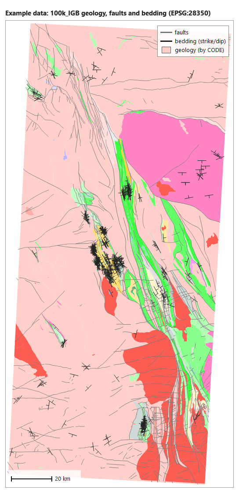

Run times quoted below are for this data on a desktop PC.

### Getting the data

The data used in the examples in this manual can be downloaded as a zip file:
[WA.zip](https://tectonique.net/GeoSubSampler/WA.zip).

These layers are clipped from the original Geological Survey of Western Australia datasets, and
reprojected from GDA2020 to GDA94 / MGA zone 50 (EPSG:28350). The original datasets are described in
these metadata statements (XML):

- [1:100 000 Interpreted Bedrock Geology (GDA2020)](https://warsydprdstadasc.blob.core.windows.net/downloads/Metadata_Statements/XML/METADATA_GEOLOGY_100k_InterpretedBedrockGeology_GDA2020.xml)
- [WAROX field observations (GDA2020)](https://warsydprdstadasc.blob.core.windows.net/downloads/Metadata_Statements/XML/METADATA_WAROX_GDA2020.xml)

---

## 3. Quick start

1. Open the project and click the GeoSubSampler icon. The dock opens on the right.
2. Choose the three layers at the top: **Select Structure Point Layer**, **Select Fault Polyline Layer**,
   **Select Litho/strat Polygon Layer**. A tool only uses the layers it needs.
3. If you will merge polygons or calculate fault offsets, set the **Geology Polygon Priorities**
   (Priority 1 = most detailed stratigraphic field, 4 = most general, 5 = lithology).
4. Work through the tabs from left to right, which is the usual order:
   - **Clean**: make the map topologically consistent (Fix Map) and, if needed, add nodes (Densify).
   - **Points**: subsample the structural measurements.
   - **Faults**: merge broken segments, then add ranking attributes.
   - **Polygons**: merge small polygons, simplify boundaries, or scale the whole map with T&P.
5. Press a tool's button. Its results are written to a new folder next to the input layer and added
   to an **Outputs** group at the top of the Layers panel, styled like their input.
6. To see how a result was made, select it in the Layers panel and press
   **Show metadata of the selected layer in the layer panel**.

Layers must be saved on disk as a shapefile or in a GeoPackage. Temporary (memory) layers cannot be
processed. Use a projected coordinate system in metres if you can: some settings are not converted
for geographic coordinates (see [Units](ReferenceManual.md#9-units-and-coordinate-systems)).

---

## 4. The dock

The dock has four tabs. The section between the tab bar and the tab contents stays the same on every
tab, so its settings are shared by all the tools:

- **Layer selectors**: the point, fault and polygon layers.
- **Show metadata of the selected layer in the layer panel**: shows the history of the layer that is
  selected in the QGIS **Layers panel** (not the layers chosen in the dock). See [Metadata](#metadata).
- **Geology Polygon Priorities**: up to five attribute fields of the polygon layer.
  - **Priority 1-4**: stratigraphic fields, from most detailed (1) to most general (4). In the example,
    `CODE`, `UNITNAME`, `PARENTCODE`, `GROUP_`.
  - **Priority 5**: the lithology field (`LITHNAME1`).
  - Used by Rescale Map, Töpfer & Pillewizer scaling (which neighbour a small polygon joins), and
    Strat Offset (Priority 1-4 only; at least one must be set).

Hover over any control for a tooltip.

---

## 5. Clean tab

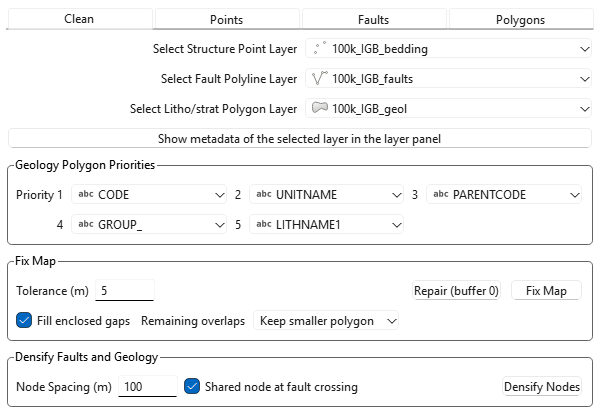

Run the Clean tools first: Fault Graph, Strat Offset and Simplify Map all depend on lines meeting at
shared nodes, and digitised maps rarely do.

### Fix Map

Makes the polygon layer and/or the fault layer topologically consistent: shared boundaries get identical
nodes, near-coincident nodes become one, gaps and overlaps are removed, doubled features are deleted,
and faults share nodes with the contacts and faults they touch or cross.

| Setting | Meaning |
|---|---|
| **Tolerance (m)** | Features closer than this are treated as meant to coincide. **No vertex moves further than this.** Default 5 m. |
| **Fill enclosed gaps** | Fill every gap completely surrounded by polygons (whatever its size) by adding it to the neighbour sharing the longest boundary. On by default. Untick it to keep real holes such as lakes. Gaps at the map edge are never touched. |
| **Remaining overlaps** | What to do with overlaps still left at the end: *Keep smaller polygon* (default: cut the overlap out of the bigger one), *Keep larger polygon*, or *Leave overlaps*. |
| **Repair (buffer 0)** | A separate button that only repairs invalid (self-intersecting) polygons. It is also the first step of Fix Map. |

Uses whichever of the polygon and fault layers are selected; both must use the same coordinate system.
Polygons are never moved by faults, and bigger polygons are never moved by smaller ones.

**Example** (tolerance 5 m, 28-36 s): 1 349 vertices moved, 2 213 nodes added along shared boundaries,
242 nodes added where lines cross, 3 doubled faults removed, 4 thin overlaps trimmed. Before -> after:
3 165 -> 0 nodes lying on a line without being one of its nodes; 3 427 -> 0 pairs of unshared nodes
closer than 5 m.

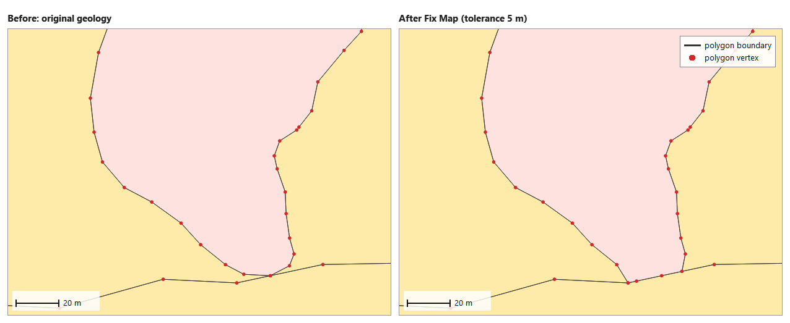

*The tip of the small polygon crossed its neighbour's boundary; after Fix Map both share the same nodes.*

When it finishes, a report window opens (also saved as `<layer>_fixed_report.txt`). While it runs, QGIS
cannot redraw, so progress is written line by line to `<layer>_fixed_progress.txt` in the run folder;
open it in a text editor to follow a long run.

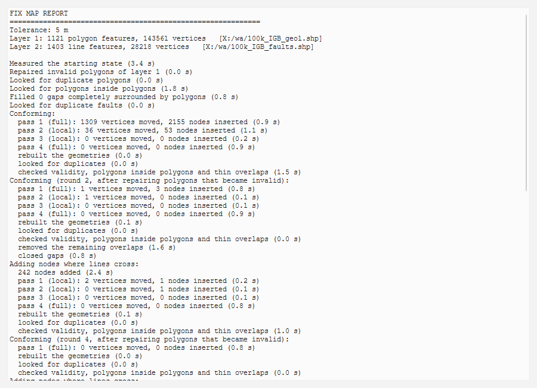

Read the report's **WHAT WAS DONE** section for anything removed (listed by feature index): duplicates,
polygons completely covered by smaller ones, and features narrower than the tolerance that collapsed.
Attributes are never edited. How it works step by step:
[Reference Manual, Fix Map](ReferenceManual.md#21-fix-map).

**Repair (buffer 0)** writes `<layer>_valid` only if there is something to repair. On the example it
reports *"there are no invalid polygons in this layer"* and writes nothing.

### Densify Nodes

Adds nodes so that no segment is longer than a chosen spacing, without changing any shape, and keeps
the layers consistent: a new node on a boundary shared by two polygons, or followed by a fault, is the
same node in all of them.

| Setting | Meaning |
|---|---|
| **Node Spacing (m)** | Longest allowed segment. Each segment is cut into equal parts no longer than this, so new nodes are between half the spacing and the spacing apart. Default 100 m. |
| **Shared node at fault crossing** | Also add a node, shared by both, where a fault or polygon boundary crosses a polygon boundary, and where a vertex touches another feature's segment (a T-junction). On by default. Fault-fault crossings are *not* noded here; Fix Map does that. |

**Example** (100 m, 3.5 s): 171 779 -> 335 985 vertices, 1 513 shared nodes added where features cross.

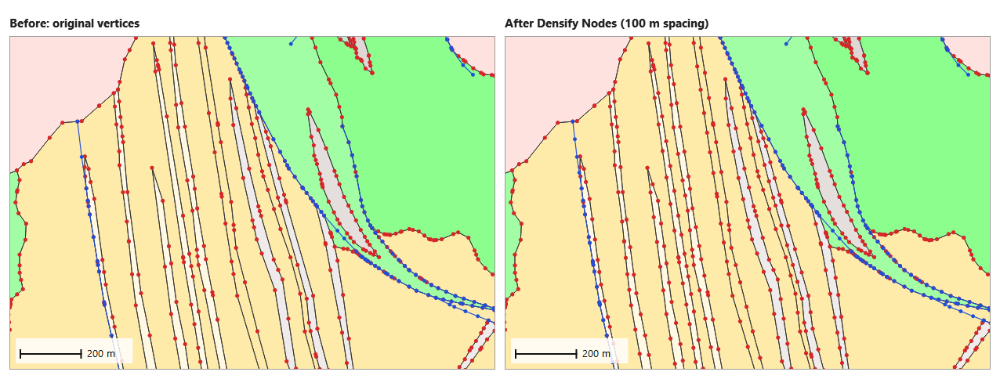

Outputs are `<layer>_dense` for each selected layer.

### Thin Nodes

The opposite of Densify: removes nodes that are closer together than a chosen distance, and keeps the
layers consistent. A node on a boundary shared by two polygons, or followed by a fault, is removed from
all of them at once, so the boundary and the fault stay on top of each other.

| Setting | Meaning |
|---|---|
| **Min Node Spacing (m)** | A node closer than this to one of its neighbouring nodes is removed, where allowed. Default 50 m. |

A node is **never** removed if it is:

- a triple junction (shared by three or more polygons);
- a place where a fault meets, leaves or crosses a polygon boundary or another fault;
- the end of a line;
- a point where a polygon touches itself.

A node is also kept if removing it would make a boundary or fault **cross** another one (or itself), or
would cut off another node, so that a feature would end up on the wrong side of a boundary. Rings are never
reduced below three nodes. The message at the end says how many close nodes were kept for this reason.

Ordinary nodes that are not shared (along the map edge, or on a fault inside a polygon) are thinned by the
same rule. Thinning only removes nodes, so it does not move any node, but a boundary can be straightened
across a bend narrower than the spacing.

Run **Fix Map** first: only nodes that are exactly shared (to 1 µm) are treated as shared.

Outputs are `<layer>_thin` for each selected layer. In QGIS each round's progress is printed in the Python
console; in ArcGIS Pro it goes to the log.

---

## 6. Points tab

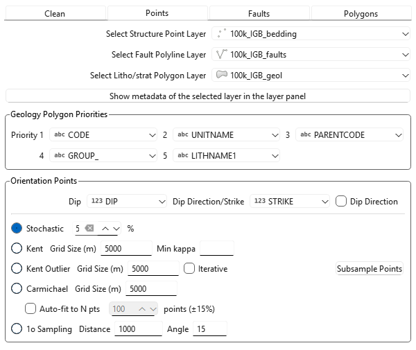

Choose the fields, choose a method, and press **Subsample Points**.

### Fields

- **Dip**: dip, 0-90°.
- **Dip Direction/Strike**: dip direction or strike, 0-360°.
- **Dip Direction**: tick if that field holds dip direction, untick if it holds strike. The example
  data hold strike, so it is unticked. Grid methods return their averages in the same convention as
  the input.

Before any method runs, measurements that cannot be used are left out: missing values, dip outside
0-90, dip direction or strike outside 0-360 (no-data codes such as 9999). A report,
`<layer>_ignored_points_report.txt`, lists them. In the example 10 of 487 points are left out (9 with no
strike, 1 with no dip). If more than 30% of the dips are outside 0-90, the Dip and Dip Direction fields
have probably been swapped: nothing is processed and a message says so.

### Choosing a method

| Method | Keeps | Use it when |
|---|---|---|
| Stochastic | a random % of the measurements | you want a simple, unbiased thinning |
| Kent | one averaged measurement per grid cell, with its Kent statistics | you want an even spatial density of representative orientations |
| Kent Outlier | as Kent, after removing the worst outlier (or several, *Iterative*) per cell | cells hold occasional bad readings |
| Carmichael | as Kent, after removing several outliers per cell (Carmichael & Aillères 2016); cells of 3 or fewer measurements are dropped | you want only well-constrained cells |
| 1o Sampling | real measurements near a contact and parallel to it | you want first-order measurements that define the contact geometry |

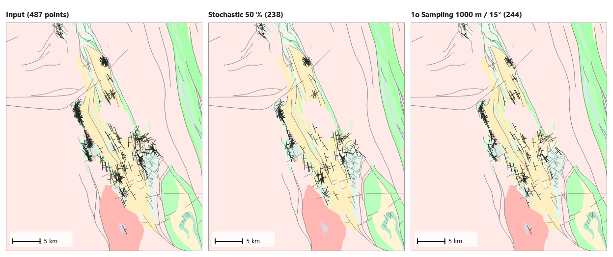

### Stochastic

- **%**: percentage of measurements to keep (default 50). A new random seed is used every time and
  recorded in the metadata. Output: `<layer>_stochastic`, with all the input fields.

### Grid methods: Kent, Kent Outlier, Carmichael

The area is divided into square cells of **Grid Size (m)** (each method has its own box; default
5 000 m), starting at the lower-left corner of the points. Each occupied cell gives one point, placed at
the **mean position** of the measurements used (not at the cell centre), with their vector-mean
orientation (rounded to 0.1°) and these fields:

| Field | Meaning |
|---|---|
| `count` | measurements used in the cell |
| `kappa` | Kent concentration (higher = tighter); -998 if undefined (one measurement, or identical ones) |
| `beta` | Kent ovalness; -998 if undefined |
| `n_removed` | (Kent Outlier, Carmichael) measurements removed as outliers |
| `REMOVED_IN` | (Kent Outlier) index of the first removed measurement, -1 if none |

The other input fields are not carried over.

- **Kent / Min kappa**: optional. Keep a cell only if its kappa is at least this (blank or 0 = keep all).
  This drops single-measurement cells and scattered cells. Example: 79 cells without a filter, 33 with
  Min kappa 5.
- **Kent Outlier / Iterative**: off = at most one outlier per cell (the one whose removal raises kappa
  most). On = several, cut at the one large jump in kappa, and only if that jump stands out
  (experimental). Example: 29 measurements removed in single mode, 64 in iterative mode.
- **Carmichael**: ranks a cell's measurements by angle from the cell mean and removes the farthest ones
  up to the biggest jump in kappa (at most half the cell). Example: 25 cells, 154 measurements removed.
- **Auto-fit to N pts**: instead of the Grid Size, search for the grid size that gives about N points
  (within ±15%). The size found is written into the method's Grid Size box and the metadata. The result
  cannot exceed the number of occupied cells. Example: N = 100 gave 98 points with 3 904 m cells.

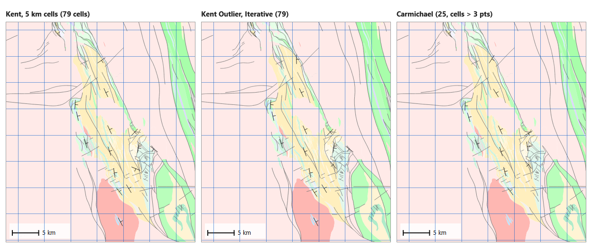

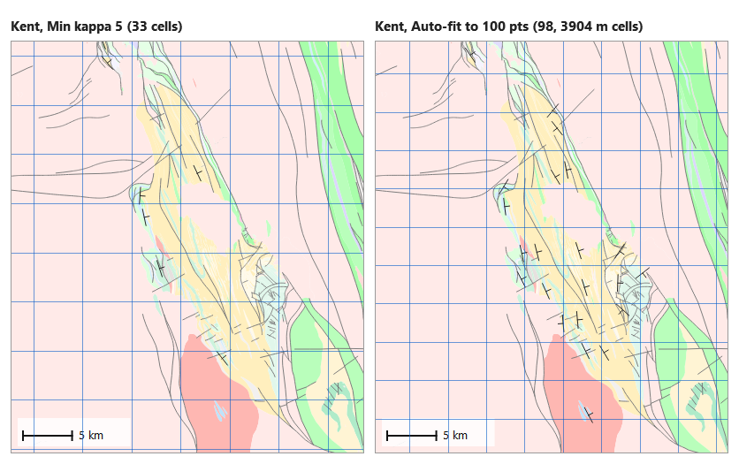

Outputs: `<layer>_grid_cell_kent`, `<layer>_grid_cell_kentOutlier` (`...Iter` when Iterative),
`<layer>_grid_cell_carmichael`.

### 1o Sampling

Keeps real measurements that are both close to a geological contact and parallel to it. The contacts
are the boundaries of the polygons in the selected polygon layer, so a polygon layer is required.

- **Distance**: keep measurements within this distance of a contact (layer units; default 1 000).
- **Angle**: and whose strike is within this many degrees of the contact's direction (default 15).

Example (1 000 m, 15°): 244 of 477 measurements kept. Output `<layer>_first_order`, with all input fields.

---

## 7. Faults tab

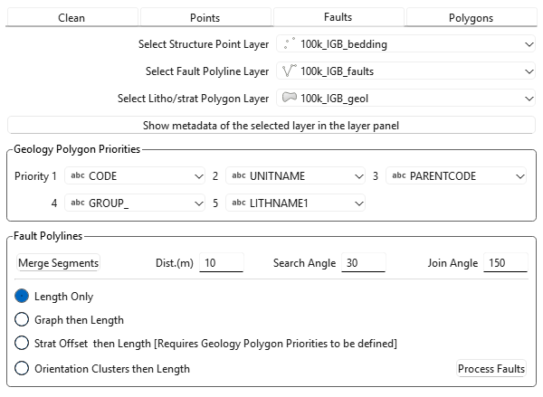

### Merge Segments

Joins fault segments whose ends nearly meet and which continue in the same direction.

| Setting | Meaning |
|---|---|
| **Dist.(m)** | Largest gap between two line ends that can be joined (layer units; default 10). |
| **Search Angle** | The end segments of the two lines must be within this many degrees of parallel (default 30). |
| **Join Angle** | The angle formed at the join must be at least this (default 150°; 180° = perfectly straight). Smaller angles, i.e. sharp bends, are rejected. |

Example: 1 403 -> 1 034 lines (0.9 s). The output `<layer>_merged` has **geometry only**: the attributes
of the input are not kept.

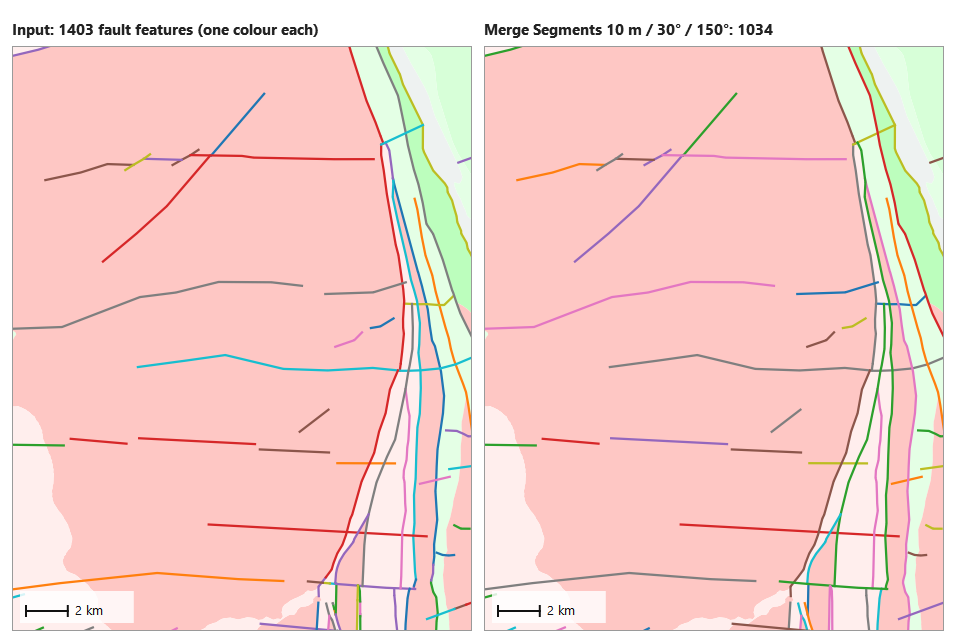

### Process Faults

Choose a method and press **Process Faults**. None of them removes faults: each writes a copy with extra
attributes and colours it by the new attribute. The method selected here is also how
[Töpfer & Pillewizer scaling](#töpfer--pillewizer-scaling) ranks the faults it keeps ("...then Length"
means ties are broken by length).

| Method | Adds | Output | Example |
|---|---|---|---|
| **Length Only** | `line_len` (length in metres) | `<layer>_length`, coloured by length | 0.3 s |
| **Graph then Length** | a fault network: each fault cut at its junctions, with `edge_type` (`X-X` junction to junction, `X-Z` junction to free end, `Z-Z` isolated) and node ids | `simplified_full_<layer>_edges` (+ `_nodes`, not added to the map) | 2 066 edges, 2 269 nodes, 3.7 s |
| **Strat Offset then Length** | the stratigraphic offset across each fault | `<layer>_stratOffset` and `<layer>_stratOffset_samples` | 6.6 s |
| **Orientation Clusters then Length** | `endpt_az` (end-to-end azimuth, 0-180), `cluster`, `cluster_ce` (cluster mean azimuth) | `<layer>_fault_clusters` (+ `<layer>_endpt_az`) | 2 clusters, 11 s |

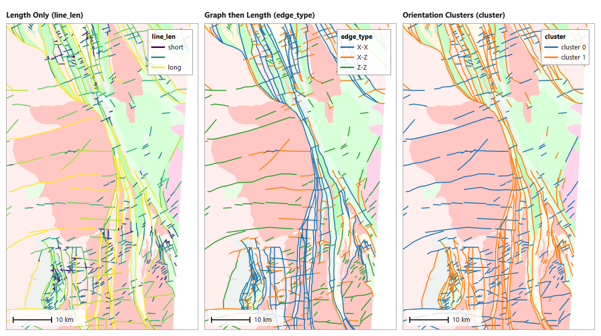

**Graph then Length** only connects faults that share a vertex. Faults that cross or touch without a
shared node are treated as separate, so run **Fix Map** (or Densify) first.

**Strat Offset then Length** needs the polygon layer and at least one of Priority 1-4. The geology is read
a few metres either side of the fault at every point where it crosses or runs along a contact, and at
its ends. Each fault gets:

| Field | Meaning |
|---|---|
| `max_off_lv` | the largest offset found: -1 edge of the map, 0 no offset, *k* = the two sides differ at Priority *k* (and all more general levels are the same). A higher number is a bigger offset. |
| `max_off_ds` | that offset in words, e.g. "Offset at PARENTCODE level (priority 3)" |
| `max_off_lo`, `max_off_x`, `max_off_y` | where it was found (contact, shared, start, midpoint, end) |
| `side1_unit`, `side2_unit` | the units on each side there |
| `n_samples`, `n_offset`, `n_nooffset`, `n_edge` | how many samples, and how many showed an offset, no offset, or the map edge |
| `sample_src` | `contacts` or `ends` (fault met no contact) |

The sample points themselves are saved as `<layer>_stratOffset_samples` (16 399 in the example) with
their offset level and the units each side.

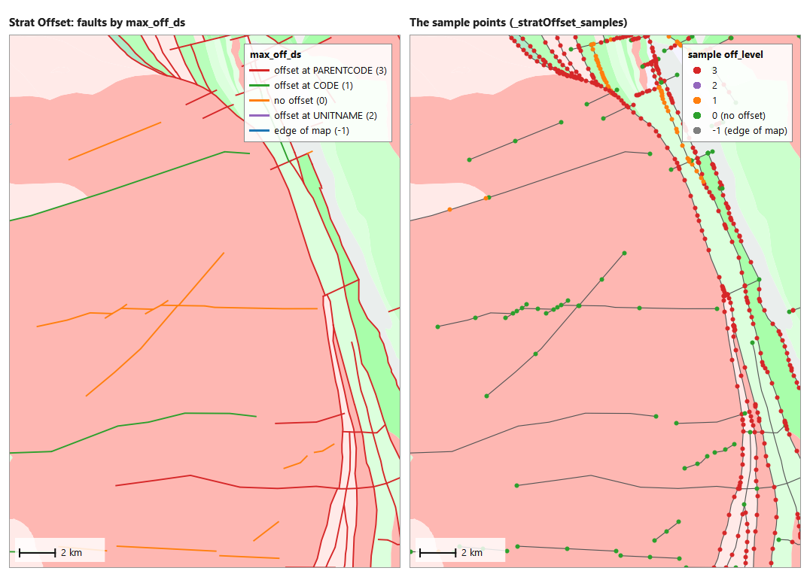

Example result: 934 faults offset at PARENTCODE level, 84 at CODE, 7 at UNITNAME, 371 with no offset,
7 at the map edge.

**Orientation Clusters then Length** tries 2 to 30 clusters of the end-to-end azimuths and keeps the
number with the best silhouette score; that number is recorded in the metadata (`best_number_of_clusters`).

---

## 8. Polygons tab

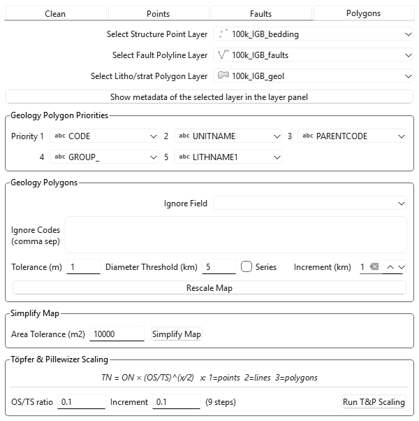

### Rescale Map (Geology Polygons group)

Removes polygons smaller than a target size by merging each into its best-matching neighbour, and fills
small holes. A small polygon joins the touching neighbour that shares its Priority 1 value, else its
Priority 2 value, ... Priority 4, then Priority 5 (lithology); among equal candidates, and if nothing
matches, the one with the longest shared boundary.

| Setting | Meaning |
|---|---|
| **Diameter Threshold (km)** | Polygons smaller than a circle of this diameter are merged; holes smaller than that are filled. Default 5. |
| **Tolerance (m)** | A small polygon that touches no other polygon (for example one separated from its neighbours by a sliver gap) may merge into a polygon within this distance, chosen by the same rules; the gap between them is filled. Polygons that do touch are not affected. Default 1. |
| **Ignore Field** / **Ignore Codes** | Polygons whose Ignore Field holds one of these comma-separated codes (e.g. dykes, alluvium) are cut into triangles before merging, so that their area is shared between the units on either side instead of being given whole to one neighbour. Only those below the size threshold are cut. |
| **Series**, **Increment (km)** | Make one map per diameter from 0 up to the threshold, in steps of the increment. Each step starts from the original layer. |

Example: 1 121 polygons -> 187 at 2 km and 77 at 5 km (3.5 s).

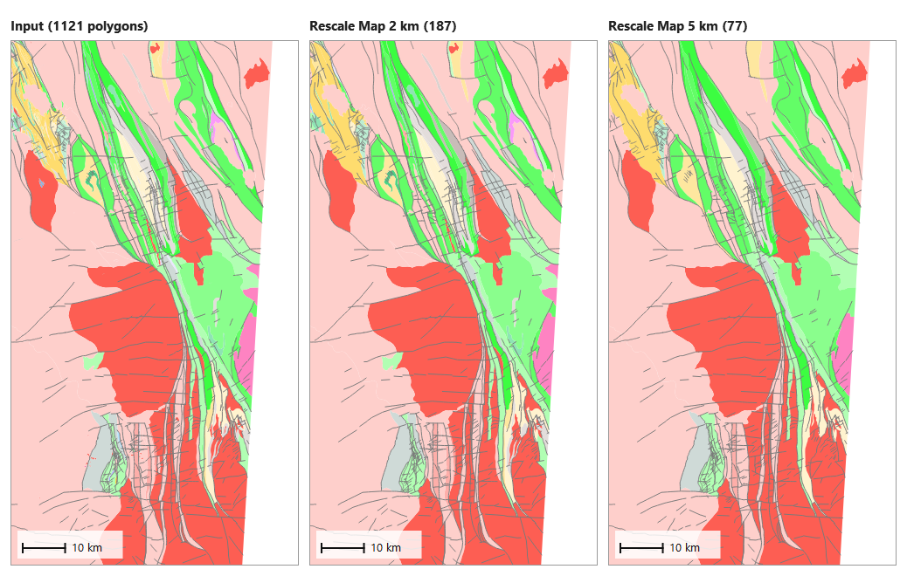

Outputs `<layer>_min_area` (a series: `_min_area_1`, `_2`, ...; step 1 is the 0 km diameter, i.e. unchanged).
Each output has `primaryid` (the polygon's original row) and `inherit` (the `primaryid`s of everything
merged into it, continued in `inherit1`, `inherit2` ... when longer than 254 characters).
A small polygon with no neighbour within the tolerance is kept.

### Simplify Map

Removes vertices from the polygon boundaries and faults together, keeping them topologically consistent:
shared boundaries are simplified the same way on both sides, junctions and fault-contact crossings are
never removed, and every pair of units in contact stays in contact. Needs both the polygon and fault layers.

- **Area Tolerance (m2)**: a vertex is removed while the triangle it forms with its two neighbours is
  smaller than this area (Visvalingam-Whyatt). Larger = simpler. Default 10 000 m².

Example (10 000 m², 21-28 s): polygon vertices 143 561 -> 51 557.

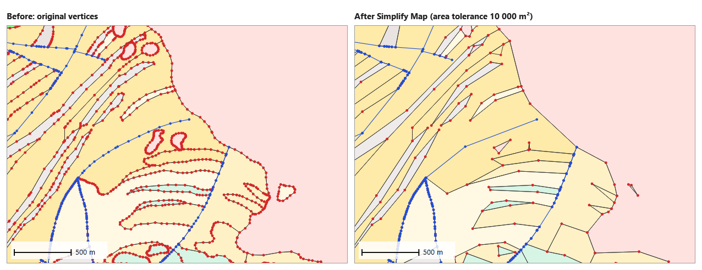

Outputs: `<polygon layer>_MVW` and the simplified faults `<fault layer>_sn_si_<tolerance>`, both added to
the map. The run folder also holds the intermediate `<polygon layer>_topo_fixed` and `<fault layer>_sn` files.

### Töpfer & Pillewizer scaling

Reduces all selected layers together to a smaller map scale, following the Töpfer & Pillewizer (1966)
rule

&nbsp;&nbsp;&nbsp;&nbsp;**TN = ON × (OS/TS)^(x/2)**

where ON and TN are the original and target number of features, OS and TS the original and target scale
denominators, and x = 1 for points, 2 for lines, 3 for polygons. Going from 1:50 000 to 1:500 000
(OS/TS = 0.1) keeps about 32% of the points, 10% of the faults and 3% of the polygons.

| Setting | Meaning |
|---|---|
| **OS/TS ratio** | the target ratio, above 0 and at most 1 |
| **Increment** | the step between ratios: with 0.1 and 0.1 the steps are 0.9, 0.8 ... 0.1 (the number of steps is shown beside it) |

It uses the settings of the other tabs, for whichever of the three layers are selected:

- **Points**: the method selected on the Points tab, always applied to the original points at the ratio
  of that step. Stochastic draws exactly the target number. A grid method searches for the grid size that
  gives the target (±15%), starting from its own Grid Size box. 1o Sampling keeps the best-ranked points
  within its Distance and Angle limits (it may find fewer than the target). %, Min kappa, Iterative and
  Auto-fit are not used.
- **Faults**: ranked by the method selected on the Faults tab and the top TN kept (longest; by
  `edge_type` then length; by offset level then length; by cluster size then length). Missing attributes
  are calculated automatically. Each step works from the previous step's faults.
- **Polygons**: the smallest polygons are merged into their best-matching neighbours until the target
  count is reached, using the priorities and the Tolerance and Ignore settings of the Geology Polygons
  group. Each step works from the previous step's polygons.

Example (ratio 0.1, increment 0.1, Kent and Length Only, 15 s). The run writes all nine steps; four are
shown here:

| OS/TS | Points (target) | Faults | Polygons |
|---|---|---|---|
| 1 (unscaled) | 477 | 1 403 | 1 121 |
| 0.5 | 299 (337) | 702 | 396 |
| 0.3 | 237 (261) | 421 | 184 |
| 0.1 | 156 (151) | 140 | 35 |

Faults and polygons hit their targets (ON × 0.5, ON × 0.5^1.5 ...) to within one feature; the grid search for
the points stops once it is within ±15%.

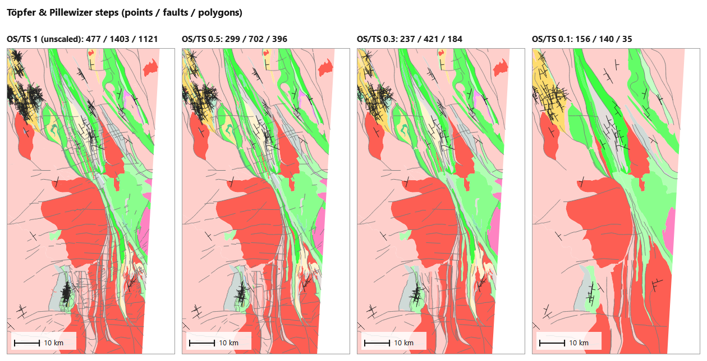

Outputs are numbered `<layer>_tp_1` (unscaled), `_tp_2`, ... and the ratio of each is in its metadata.
A report of every step, with the targets and the settings actually used (e.g. the grid size found), is
saved as `TP_scaling_report_<date>_<time>.csv`. In the Layers panel the results go in a **T&P** group,
with one sub-group per step named after its ratio and the time of the run. Only one step is visible at a
time, so ticking a step switches the whole map to that scale.

---

## 9. Results, file names and metadata

### Where results go

Every button press writes to a **new folder** named after the tool and the time, e.g.
`Fix_map_20261112_080703`, next to the input layer (or in the project folder, or the temp folder, if
that is not writable). A series (Rescale Map, T&P) puts all its steps in one folder. Nothing is ever
overwritten. New layers go in the **Outputs** group at the top of the Layers panel, newest on top, styled
like their input (fault attribute tools colour by the new attribute instead).

| Tool | Run folder | Outputs |
|---|---|---|
| Fix Map | `Fix_map_...` | `<layer>_fixed`, `<layer>_fixed_report.txt`, `<layer>_fixed_progress.txt` |
| Repair | `Repair_polygons_...` | `<layer>_valid` |
| Densify Nodes | `Densify_nodes_...` | `<layer>_dense` |
| Thin Nodes | `Thin_nodes_...` | `<layer>_thin` |
| Point methods | `Point_subsampling_...` | `<layer>_stochastic`, `_grid_cell_kent`, `_grid_cell_kentOutlier(Iter)`, `_grid_cell_carmichael`, `_first_order`, `_ignored_points_report.txt` |
| Merge Segments | `Fault_segment_merging_...` | `<layer>_merged` |
| Process Faults | `Fault_processing_...` | `<layer>_length`, `simplified_full_<layer>_edges/_nodes`, `<layer>_stratOffset(_samples)`, `<layer>_fault_clusters`, `<layer>_endpt_az` |
| Rescale Map | `Polygon_cleaning_...` | `<layer>_min_area` (`_1`, `_2` ... for a series) |
| Simplify Map | `Map_simplification_...` | `<layer>_MVW`, `<faults>_sn_si_<tol>`, `<layer>_topo_fixed`, `<faults>_sn` |
| T&P | `Topfer_Pillewizer_scaling_...` | `<layer>_tp_1` ... `_tp_n`, `TP_scaling_report_<date>_<time>.csv` |

File names carry the tool, not its settings; the settings are in the metadata.

### Metadata

Every shapefile written gets a metadata file beside it, `<file>.shp.sgt.xml` (the same format as the
SGTool plugin). It records when the file was made and by which version, the tool and every setting used
(including values only known after the run: the grid size Auto-fit found, the random seed, the ratio of
each T&P step, the best number of clusters), and the files it was made from. If those files were
themselves made by GeoSubSampler or SGTool, their history is included, so the whole chain of processing
is kept.

Select a layer in the Layers panel and press **Show metadata of the selected layer in the layer panel**.
The **History** tab shows it as a table; the **XML** tab shows the file.

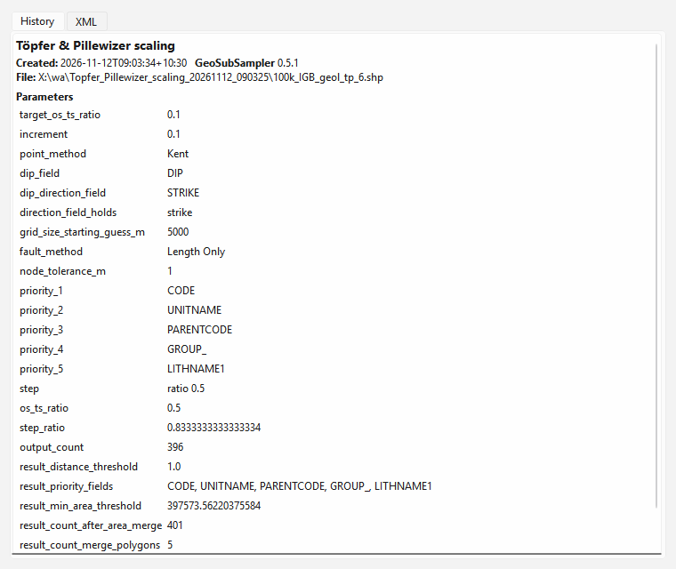

---

## 10. Tips, messages, known issues and caveats

**Good practice**

- Run **Fix Map** before the fault tools and Simplify Map, and check its report.
- Use a projected CRS in metres (see [Caveats](#caveats)).
- Set the Geology Polygon Priorities before Rescale Map, T&P and Strat Offset.
- Large maps: Fix Map took about 3 minutes on a 1 900-polygon / 670 000-vertex map and about 27 minutes on
  a 3.9-million-vertex map. Follow it in the progress file.

**Messages**

| Message | Meaning |
|---|---|
| *Please define dip & dip dir/strike fields before continuing!* | choose both point fields |
| *N of M points have unusable dip / dip direction values and were ignored* | see `<layer>_ignored_points_report.txt` |
| *Dip field ... has values outside 0-90 degrees ... swapped?* | more than 30% of dips are impossible; swap the fields |
| *Kent: no cell reached Min kappa ...* | lower Min kappa or enlarge the grid |
| *Carmichael: no cell had more than 3 measurements* | enlarge the grid |
| *Fault Strat Offset: please select at least one priority field* | set Priority 1-4 |
| *Ignore codes not found in field ...* | the codes do not match the field's values (the message lists some) |
| *Sorry, only layers saved to disk ... can be processed!* | save the layer as a shapefile or GeoPackage |
| *The polygon and fault layers are in different coordinate systems* | reproject one of them (Fix Map, Densify) |

### Known issues

These are behaviours that are not what you would want, and may be changed:

- **Merge Segments drops the fault attributes.** The merged layer has geometry only; join attributes back
  yourself if you need them.
- **Long `inherit` lists with Ignore Codes.** Every triangle of a triangulated polygon has its own
  `primaryid`, so the polygons that absorb a dyke can get many `inherit1`, `inherit2` ... columns.
- **T&P counts triangles.** With Ignore Codes, the triangles count as polygons when T&P works out how many
  to merge in its first pass; the second pass still reaches the target count.

### Caveats

Things that work as designed but are easy to trip over:

**Input**

- Tools read the layer **files**, not QGIS's in-memory features: save your edits first. A GeoPackage layer
  is exported to a shapefile beside it (again whenever the GeoPackage has changed), and field names longer
  than 10 characters are shortened.
- Several settings are used in **layer units**, so in a geographic CRS they are in degrees: 1o Sampling
  **Distance**, Merge Segments **Dist.** and Simplify Map **Area Tolerance**. Grid sizes and the Rescale
  Map settings are converted with 110 km per degree (in both directions), and fault lengths with
  111 km × cos(latitude), which is exact only for east-west faults. Use a projected CRS in metres.

**Clean**

- **Fix Map can remove features**: duplicates, polygons completely covered by smaller ones, and polygons or
  faults narrower than the tolerance. They are listed by index in the report. Gaps and overlaps are resolved
  by size and shared boundary length, not by geology, and where several vertices snap to the same nodes a
  line can end up slightly further than the tolerance from where it was (the report says how far).
- **Densify Nodes** does not add nodes where two faults cross each other; Fix Map does.
- **Thin Nodes** treats nodes as shared only if they coincide to within 1 µm, so run Fix Map first. It
  removes nodes by distance only, so it can straighten a bend narrower than the spacing (it never makes
  lines cross).

**Points**

- **Grid methods** keep only the averaged orientation and their statistics, not the other input fields,
  and place each point at the mean position of the measurements in its cell. Near-identical measurements give
  very large kappa values (10⁸ in the example).
- **Auto-fit** and T&P's grid search stop once they are within ±15% of the target, so the count is often a
  little under it (10-12% under in the example).
- **Stochastic** uses a new random seed each run (recorded in the metadata), so two runs differ.

**Faults**

- **Graph then Length** connects faults only where they share a vertex. Run Fix Map first, or crossing
  faults are treated as separate.
- **Strat Offset** reads the first polygon containing each side point; overlapping polygons give an
  arbitrary answer. Side points that fall outside every polygon count as the map edge (-1). The side steps
  (5 m at contacts, 50 m at fault ends) are fixed.
- **Orientation Clusters** uses the straight line between a fault's two ends, so it ignores curvature. When T&P
  has to compute clusters itself, it tries only 2 to 7 clusters (the tool tries 2 to 30).

**Polygons**

- **Rescale Map Tolerance** only affects small polygons that touch no other polygon (6.1 in the Reference
  Manual). The gap filled when such a polygon merges is the area within the tolerance of both polygons.
- **Simplify Map** keeps one shared vertex for every pair of touching polygons with different values in a
  field called `CODE`; if the layer has no `CODE` field, that safeguard is skipped. Faults are cut into arcs
  at junctions, so the simplified fault file can have more stored vertices than the input.
- **T&P** reduces points from the original points at every step, but faults and polygons from the previous
  step. It ignores Min kappa, Iterative and Auto-fit.

**ArcGIS Pro**

- The ArcGIS Pro window uses the same calculation code but was not re-run for this manual.
